# ccli

A terminal tool for every Claude Code session on your machine, across all of
your accounts. It shows what each session used and what that would cost at API
list price, turn by turn: every prompt you typed, what the model did with it,
which subagents and workflow runs it started and what they cost. It also shows
where your subscription limits stand, and it moves a session from one account
to another and back without mixing up whose usage is whose.

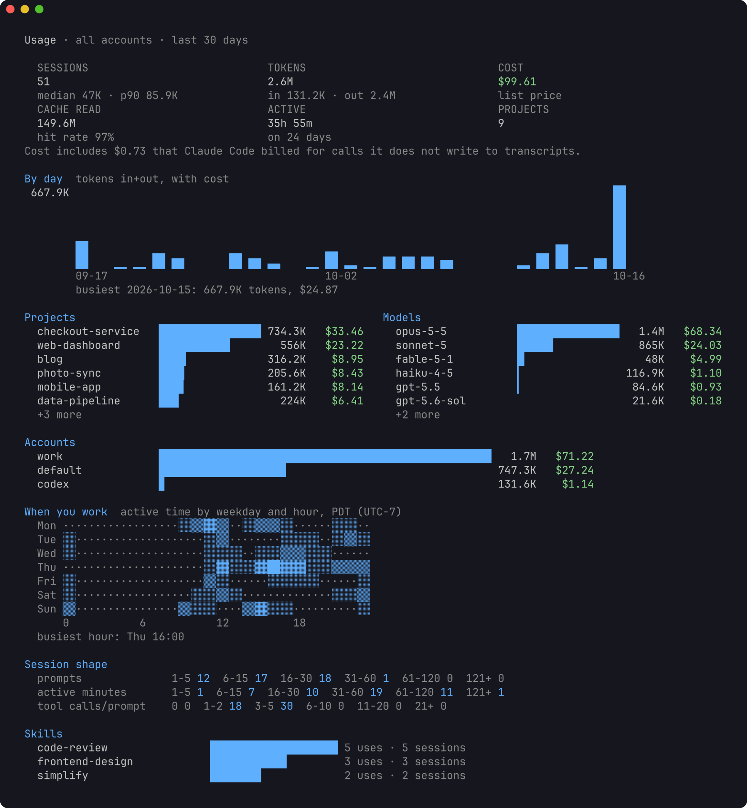

An account is one Claude Code config dir: `~/.claude` (shown as `default`) or
`~/.claude-<name>` (shown as `<name>`), the dir you select with
`CLAUDE_CONFIG_DIR`. If you keep a personal and a work login side by side,
ccli sees both and keeps their usage apart.

The [tutorial](docs/tutorial.md) walks through the common jobs step by step:
reviewing your prompts, following agents, switching accounts and watching
your limits.

## Install

Requires Go 1.26 or later.

```sh
go install github.com/lr00rl/ccli@latest
```

Or from a checkout: `go build -o ~/.local/bin/ccli .`

The first command indexes every transcript. That takes about 10 seconds for
4 GB on an M-series Mac. Later commands read only what was added since and
return in well under a second.

## Quick start

```sh
ccli stats                    # where your usage went in the last 30 days
ccli prompts --sort cost      # the prompts that cost the most
ccli log <id>                 # one session, turn by turn
ccli view                     # browse everything interactively
```

To try it on made-up data first, see [demo data](#screenshots-and-demo-data).

## What it shows

### Accounts

```sh
ccli accounts
```

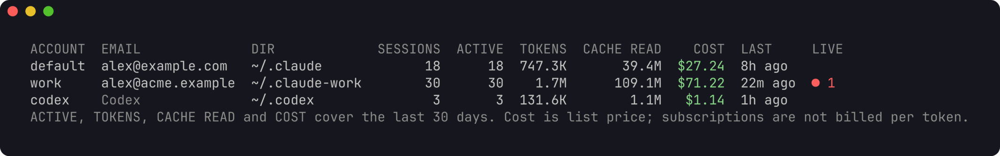

Each account with its signed-in email, session count, usage over the last 30
days, and the Claude Code processes running in it right now.

### Sessions

```sh
ccli sessions                         # active in the last 30 days, newest first
ccli sessions -a work --days 7 --sort cost -n 20
ccli sessions --project checkout -q payment
```

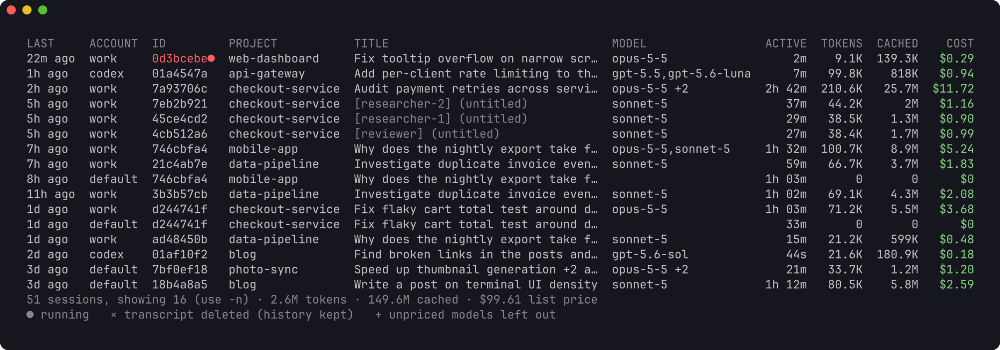

Teammates of an agent team appear with their name in brackets. A red id is a
session that is running now.

### One session

```sh
ccli show 928fce20            # an id prefix is enough
ccli show work:928fce20       # name the account when a session exists in two
ccli resume 928fce20          # cd to its folder and run claude --resume in its account
```

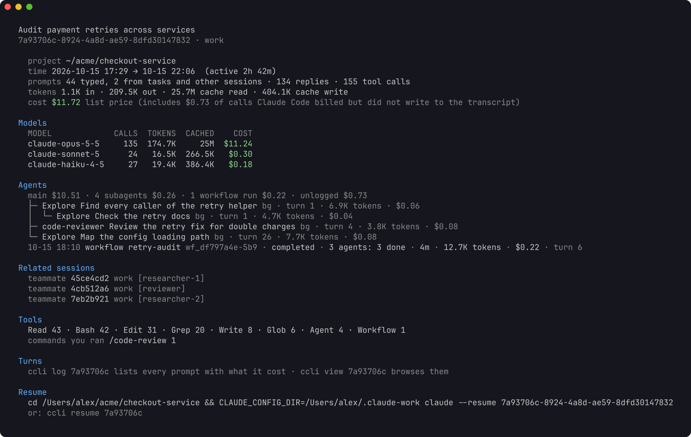

`show` prints the models used, then a line that splits the cost between the
main conversation, its subagents, its workflow runs, and calls Claude Code
billed but did not log; the parts add up to the total. Below it come the tree
of subagents (including subagents started by subagents), each with the turn
that started it, and the workflow runs with their name, status and how their
agents ended. Then teammates and continued sessions, the tools the model
called, the slash commands you ran, and the exact command to resume the
session under the right account.

### Turn by turn

```sh
ccli log 928fce20             # every prompt you typed, with what its turn cost
ccli log 928fce20 3           # one turn in full; 3-6 for a range, last for the latest
ccli log 928fce20 3 --tools   # with tool inputs and outputs
ccli log 928fce20 --sort cost # the costliest turns first
ccli log 928fce20 --agent 55fe21fd   # a subagent's own transcript
ccli log 928fce20 --run wf_b1a8      # a workflow run's agents and how each ended
```

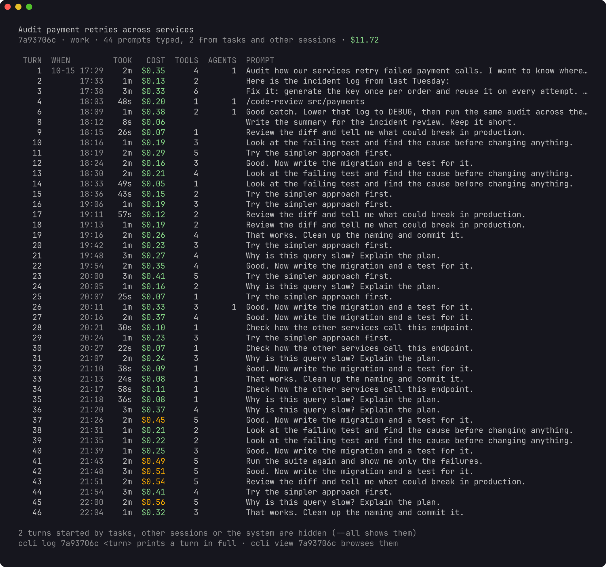

A turn is a prompt and everything up to the next one. Its cost includes the
subagents and workflow runs it started, so a two-word "go on" that launched a
large workflow shows up as the expensive prompt it was. The costliest tenth of
your turns is marked in amber. Turns started by background task reports,
messages from other sessions and the system are hidden unless you add `--all`.

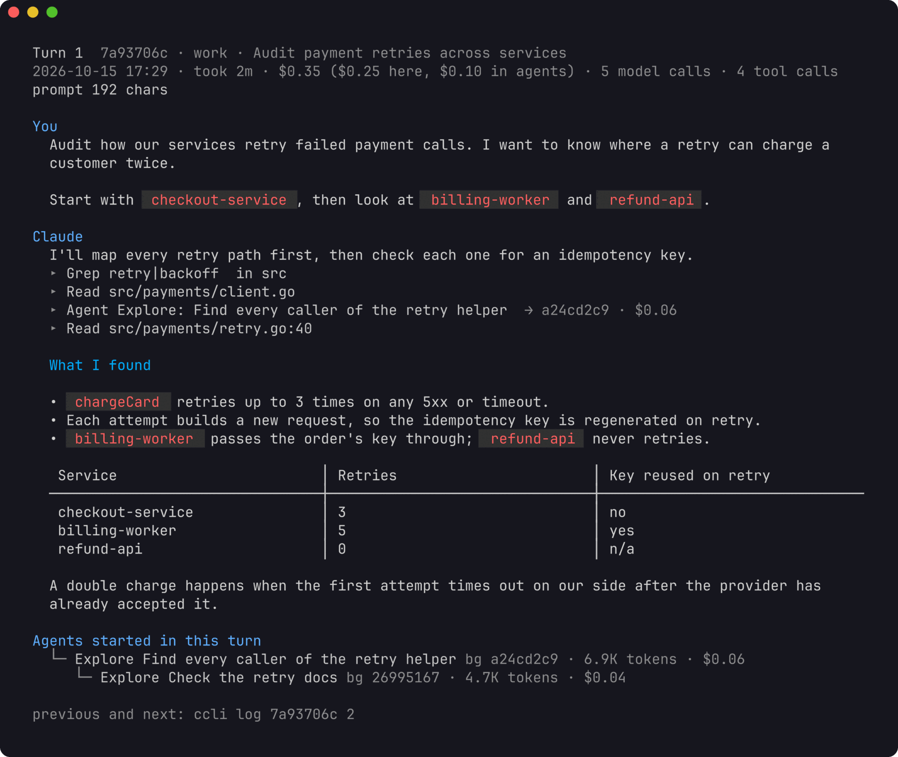

One turn prints your prompt and the model's replies rendered as markdown, a
line per tool call (with `--tools`, its input and output), the prompt each
subagent was given, and the agents and workflow runs the turn started.
`--thinking` adds the model's thinking and `--context` the text Claude Code
added on its own: skill bodies, reminders and messages from other sessions.
Long output goes through your pager.

```sh
ccli view                     # browse all sessions
ccli view 928fce20            # start at one session's turns
```

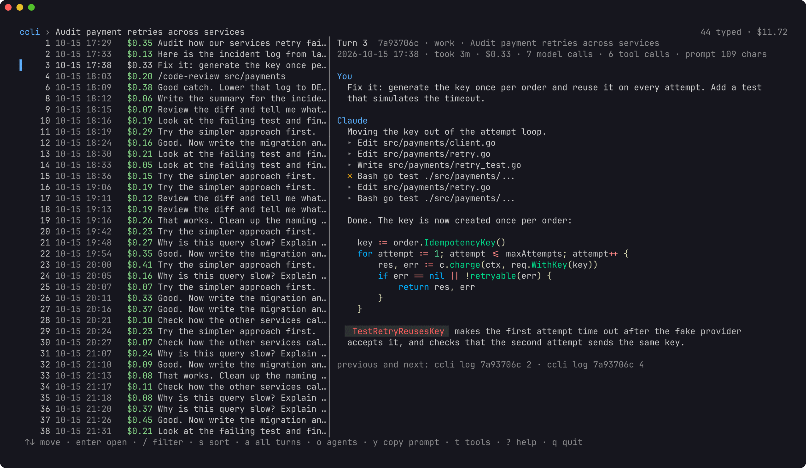

`view` is the same in an interactive browser: sessions grouped by project,
each project under a title in its own color, then a session's turns, then the agents a turn started (`o`), then an agent's transcript or a
workflow run's agents. The preview follows the selection. `/` filters by what
the prompt says, `s` sorts by cost, `y` copies the prompt to the clipboard,
and `t`, `T` and `c` toggle tool details, thinking and added context. The
mouse wheel scrolls the pane under the pointer; `?` lists every key.

```sh
ccli prompts --sort cost      # your costliest prompts across all sessions
ccli prompts -q "migration" --days 7
```

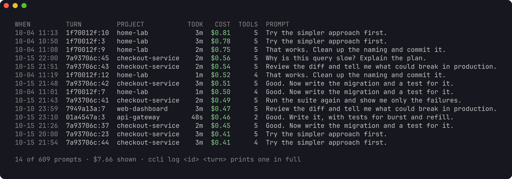

`prompts` lists what you typed across every session, which is the quickest way
to find the prompts worth rewriting. Each row names the session and turn to
open with `ccli log`.

### Dashboard

```sh
ccli stats                    # last 30 days (shown at the top of this page)
ccli stats --days 0           # all time
ccli stats -a work --project checkout
```

Totals, a daily chart, the top projects and models, usage per account, a grid
of the hours you work, how long sessions run, and which skills you call.

### Subscription limits

```sh
ccli quota
```

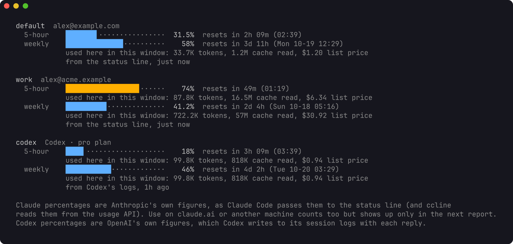

For each account: how much of the 5-hour and the weekly window is used, when
each resets, and what this machine used inside each window, counted from the
window's real start. The percentages are Anthropic's own figures. ccli takes
them from two places, whichever reported last:

- Claude Code passes `rate_limits` to your status line command after each
  reply. To let ccli record them, put `ccli statusline --` in front of your
  status line command in each account's `settings.json`. The wrapper passes
  input and output through unchanged and adds about 20 ms.

  ```json
  "statusLine": { "type": "command", "command": "ccli statusline -- <your current command>" }
  ```

- If you use [ccline](https://github.com/Haleclipse/CCometixLine), its cache
  in `<config dir>/ccline/.api_usage_cache.json` holds the same percentages
  from the usage API, often fresher when an account has been idle. ccli reads
  only those numbers.

Use on claude.ai, the desktop app or another machine counts toward the same
limits but appears only in the next report. When a window has reset since the
last report, `quota` says so, and whether anything was used here since.

### Moving between accounts

```sh
ccli diff default work                    # which sessions are in one account, both, or ahead
ccli copy dfaae500 --from work --to default
ccli move --from work --to default --project checkout --apply
```

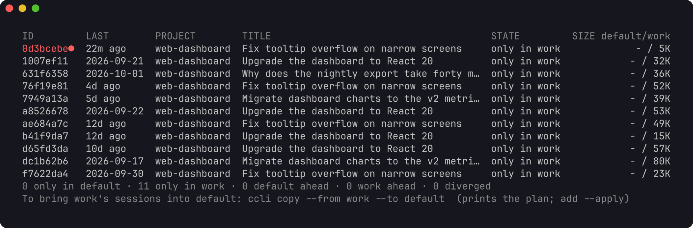

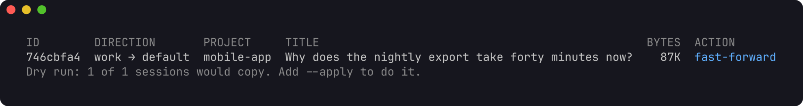

`copy` and `move` print a plan and change nothing until you add `--apply`.
A copy extends the target only when the target's transcript is an exact
prefix of the source (a fast-forward). It refuses when the target is newer,
when the two have diverged, or when a Claude Code process is running the
session in any account. `move` copies, checks every file byte for byte, and
then archives the source under `~/.local/share/ccli/archive/` instead of
deleting it. Sessions whose working folder changed have folders under several
project keys; all of them travel with the session.

To keep working on one session from two accounts, switch with `resume`:

```sh
ccli resume dfaae500 -a default --sync    # bring default's copy up to date, then resume there
# ... work in default, then later:
ccli resume dfaae500 -a work --sync       # back to work, with what you did in default
```

Without `--sync`, `resume -a` tells you when that account's copy is behind
and changes nothing. If both copies went on separately they have diverged,
and ccli will not merge them: `resume -a` resumes that account's own copy and
notes the other one. To continue the other copy here, fork it into a new
session:

```sh
ccli fork 60748107 --from work --to default --apply
```

A fork copies the transcript and its folders under a new session id, so the
copy and the original each go on.

Usage stays with the account that made it, however often a session goes back
and forth. ccli records every byte range it copies into an account, and a
response that came in with a copy never counts toward the account it was
copied into. A forked session starts at $0 in its new account.

Every command takes `--json` and prints the same structures, for scripts and
for a web view that can be added later on top of the same query layer. The
tutorial has [examples with jq](docs/tutorial.md#script-it).

## Commands

| Command | What it does |
|---------|--------------|
| `ccli accounts` | accounts with email, sessions, 30-day usage and what is running now |
| `ccli sessions` | sessions with tokens and cost; filter by account, days, project, model, title |
| `ccli show <id>` | one session: models, cost split, agent tree, workflow runs, tools, resume command |
| `ccli log <id> [turn\|N-M\|last]` | the session turn by turn, or turns in full; `--agent` and `--run` for agents |
| `ccli prompts` | your prompts across sessions; sort by cost, tools, duration, tokens or length |
| `ccli view [id]` | interactive browser over sessions, turns and agents |
| `ccli stats` | dashboard: totals, daily chart, projects, models, accounts, hours, skills |
| `ccli quota` | 5-hour and weekly limits per account, with reset times |
| `ccli diff <a> <b>` | sessions only in one account, in both, ahead or diverged |
| `ccli copy\|move <id>... --to <acct>` | copy a session to another account; `move` archives the source |
| `ccli fork <id> --to <acct>` | continue a session under a new id, in any account |
| `ccli resume <id> [-a <acct> --sync]` | run `claude --resume` in the right account and folder |
| `ccli statusline -- <cmd>` | status line wrapper that records the rate limits |
| `ccli index [--rebuild]` | update the index (every other command does this first) |

`ccli <command> -h` lists a command's flags. Session ids can be shortened to
any unique prefix, or written `account:id` to pick one account's copy.

## How it counts

Costs are list prices from an embedded table, plus $0.01 per server-side web
search. Override any model in `~/.config/ccli/prices.json`. Subscriptions are
not billed per token; the figure says what the same work would cost on the
API. Calls to a model the table does not know are counted in tokens and left
out of cost, never counted as zero.

Claude Code writes one API response as several transcript lines. ccli counts
each response once. A response that also appears in another file belongs to
the file that made it: never to one ccli copied it into, and otherwise to the
file created first.

Claude Code also makes calls it never writes to the transcript. Each process
records its own running totals (`cost-state`), and where those show tokens the
transcript lacks, ccli adds the missing tokens to the session at base list
price. `ccli show` says how much of a session's cost came from such calls.

A prompt counts as typed when a person sent it: typed, a slash command, an
accepted suggestion, or sent from the desktop or a phone. Background task
reports, messages from other Claude sessions and system prompts start turns
of their own but are counted apart. When Claude Code writes part of a
conversation again on resume, the repeat is recognised by its prompt ids and
counted once.

## What it touches

ccli reads transcripts and keeps its own index in
`~/.local/share/ccli/ccli.db`. It never reads credentials or the Keychain,
never writes `settings.json` or `.claude.json`, and never calls a model. Only
`copy`, `move`, `fork` and `resume --sync` write into an account, and only the
files of the session involved. A transcript that cannot be read is reported
and retried on the next run. [DESIGN.md](DESIGN.md) has the full contract, the
transcript fields used and the store schema.

## Retention

Claude Code deletes transcripts that have not changed for `cleanupPeriodDays`
(30 by default). ccli keeps its totals and your prompts after that, so the
history stays complete, but opening an old turn, resuming or copying a session
needs its transcript. To keep them longer, raise the setting in each account's
`settings.json`:

```json
"cleanupPeriodDays": 180
```

## Screenshots and demo data

The screenshots on this page and in the tutorial come from a made-up home
directory with two accounts, generated by `scripts/demo`. No real session data
is in them. You can try ccli on it without touching your own data:

```sh
go run github.com/lr00rl/ccli/scripts/demo@latest -home /tmp/ccli-demo
HOME=/tmp/ccli-demo XDG_DATA_HOME=/tmp/ccli-demo/.local/share ccli stats
```

`scripts/screenshots.sh` regenerates the images (it needs `jq`, `tmux` and
[freeze](https://github.com/charmbracelet/freeze)).

## Development

```sh
go vet ./...
go test -race ./...
```

Tested on macOS. It builds for Linux, which uses `statx` for file creation
times, but has not been run there yet.
