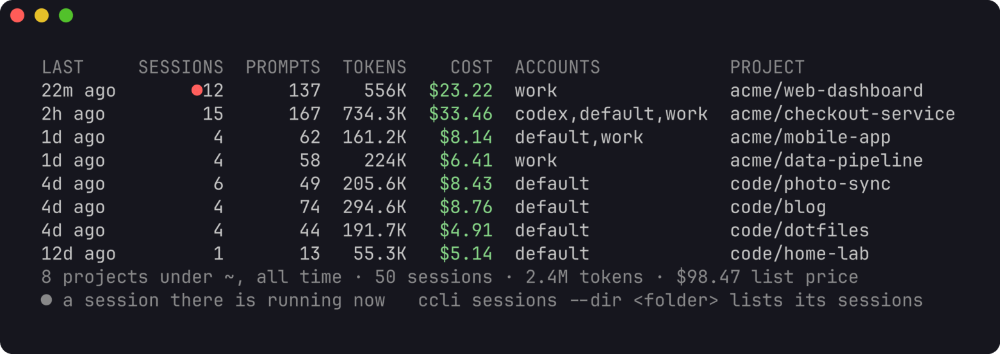
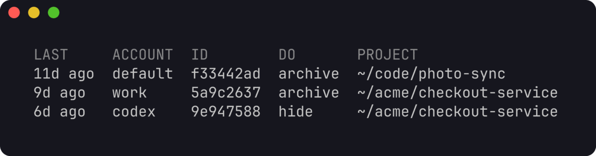
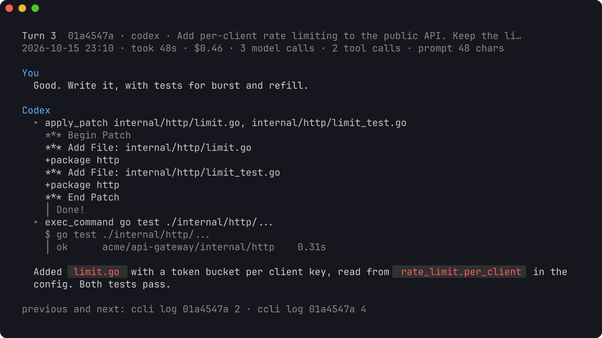

# ccli

A terminal tool for every Claude Code, Codex, Pi, and Cursor session on your
machine, across all of your accounts. The Cursor CLI and the Cursor IDE are
separate accounts: the same conversation is not merged across them. It shows
what each session used and what that cost, turn by turn: every prompt you
typed, what the model did with it, which subagents and workflow runs it
started and what they cost. It also shows where your subscription limits
stand, moves a Claude Code session from one account to another and back
without mixing up whose usage is whose, and clears out sessions that hold
nothing.


An account is one Claude Code config dir: `~/.claude` (shown as `default`) or
`~/.claude-<name>` (shown as `<name>`), the dir you select with
`CLAUDE_CONFIG_DIR`. A Codex home is an account too: `~/.codex` (shown as
`codex`) or `~/.codex-<name>`. Pi's agent dir `~/.pi/agent` is `pi`
(`PI_CODING_AGENT_DIR` for another). The Cursor CLI home `~/.cursor` is
`cursor`. The Cursor IDE user directory is `cursor-ide`. If you keep a
personal and a work login side by side, ccli sees both and keeps their usage
apart.

The [tutorial](docs/tutorial.md) walks through the common jobs step by step:
reviewing your prompts, following agents, switching accounts and watching
your limits.

## Install

Requires Go 1.26 or later.

```sh
go install github.com/lr00rl/ccli@latest
```

Releases are tagged: `@latest` installs the newest one, `@main` the newest
code, and `ccli version` says which you have. Or from a checkout:
`go build -o ~/.local/bin/ccli .`

The first command indexes every transcript. That takes about 10 seconds for
4 GB on an M-series Mac. Later commands read only what was added since and
return in well under a second.

## Quick start

```sh
ccli stats                    # where your usage went in the last 30 days
ccli prompts --sort cost      # the prompts that cost the most
ccli log <id>                 # one session, turn by turn
ccli view                     # browse everything interactively
```

To try it on made-up data first, see [demo data](#screenshots-and-demo-data).

## What it shows

### Accounts

```sh
ccli accounts
```


Each account with its signed-in email, session count, usage over the last 30
days, and the Claude Code processes running in it right now.

### Sessions

```sh
ccli sessions                         # active in the last 30 days, newest first
ccli sessions -a work --days 7 --sort cost -n 20
ccli sessions --project checkout -q payment
ccli sessions --dir . --days 0        # every session started in this folder or below
ccli sessions --tool codex            # only Codex sessions (or claude, pi, cursor, cursor-ide)
```


Teammates of an agent team appear with their name in brackets. A red id is a
session that is running now.

To stop seeing sessions you are done with, hide them:

```sh
ccli hide 3b3b57cb 21c4ab7e           # leave them out of lists
ccli sessions --hidden                # list only hidden sessions
ccli unhide 3b3b57cb                  # bring one back
```

Hiding is a mark in ccli's own index: the transcripts stay where Claude Code
put them, `resume` still works, and totals in `stats` and `quota` still count
hidden sessions. A hidden session that is used again shows again by itself.

To label sessions so you can tell them apart:

```sh
ccli tag 3b3b57cb dedupe fix
ccli tag 3b3b57cb --clear             # remove the tag
```

A tag shows in its own column next to the session's title, which never
changes. Lists add the TAG column only when some session on them has a tag,
`show` prints it, and search finds a session by its tag as well as its title.
The tag is kept in ccli's index too, so nothing is written to the transcript
and the session keeps its place in the list. It labels the session's copies
in other accounts and works for Codex sessions. To change the title Claude
Code itself shows, use `/rename` inside Claude Code; ccli reads that title.

### Projects

```sh
ccli projects                         # folders sessions started in, here or below
ccli projects ~/acme --depth 1        # one row per folder directly under ~/acme
ccli projects / --sort cost           # every project on the machine, costliest first
```



Every session records the folder it started in (its `cwd`), and `projects`
groups sessions by that folder: how many there are, when one last ran, the
prompts, tokens and cost, and which accounts they ran in. It covers all time
unless you pass `--days` or `--since`. `--depth 1` counts worktrees and
subfolders toward the folder above them. `--dir <folder>` narrows `sessions`,
`prompts`, `stats` and `view` the same way. A folder matches by whole path
segments, so `~/code/app` does not match `~/code/app2`, and symlinks are
resolved (macOS records `/tmp` as `/private/tmp`). A folder you have deleted
still works, since its sessions are still in the index.

### One session

```sh
ccli show 7a93706c            # an id prefix is enough
ccli show work:7a93706c       # name the account when a session exists in two
ccli resume 7a93706c          # cd to its folder and run claude --resume in its account
```


`show` prints the models used, then a line that splits the cost between the
main conversation, its subagents, its workflow runs, and calls Claude Code
billed but did not log; the parts add up to the total. Below it come the tree
of subagents (including subagents started by subagents), each with the turn
that started it, and the workflow runs with their name, status and how their
agents ended. Then teammates and continued sessions, the tools the model
called, the slash commands you ran, and the exact command to resume the
session under the right account.

### Turn by turn

```sh
ccli log 7a93706c             # every prompt you typed, with what its turn cost
ccli log 7a93706c --detail reply   # the whole session: your prompt and each turn's last reply
ccli log 7a93706c 3           # one turn in full; 3-6 for a range, last for the latest
ccli log 7a93706c 3 --detail reply # that turn without the tool calls
ccli log 7a93706c 3 --tools   # with tool inputs and outputs
ccli log 7a93706c --sort cost # the costliest turns first
ccli log 7a93706c --agent a24cd2c9   # a subagent's own transcript
ccli log 7a93706c --run wf_df79      # a workflow run's agents and how each ended
```


A turn is a prompt and everything up to the next one. Its cost includes the
subagents and workflow runs it started, so a two-word "go on" that launched a
large workflow shows up as the expensive prompt it was. The costliest tenth of
your turns is marked in amber. Turns started by background task reports,
messages from other sessions and the system are hidden unless you add `--all`.


One turn prints your prompt and the model's replies rendered as markdown, a
line per tool call (with `--tools`, its input and output), the prompt each
subagent was given, and the agents and workflow runs the turn started.
`--detail reply` leaves the tool calls and the earlier replies out, and
prints the prompt with the turn's last reply. Without a turn number it
prints the whole session that way.
`--thinking` adds the model's thinking and `--context` the text Claude Code
added on its own: skill bodies, reminders and messages from other sessions.
Long output goes through your pager.

```sh
ccli view                     # browse all sessions
ccli view 7a93706c            # start at one session's turns
```


`view` is the same in an interactive browser: sessions grouped by project,
each project under a title in its own color, then a session's turns, then the
agents a turn started (`o`), then an agent's transcript or a workflow run's
agents. The preview follows the selection. `/` filters by what the prompt
says, `s` sorts by cost, and `y` copies the prompt to the clipboard. `t`
expands each tool call in place, in the order it happened, next to the prompt
and the reply. `]` opens one call on its own, and `[` and `]` move between
calls. `T` and `c` toggle thinking and added context. `ccli view --tools` and
`ccli view --verbose` start with the calls already expanded. In the sessions
list, `m` marks sessions and `x` hides the marked ones (or the selected one)
after asking; `H` lists hidden sessions, where `u` brings them back; `#`
tags the selected session in a line at the bottom. The mouse wheel scrolls
the pane under the pointer; `?` lists every key.

```sh
ccli prompts --sort cost      # your costliest prompts across all sessions
ccli prompts -q "migration" --days 7
```


`prompts` lists what you typed across every session, which is the quickest way
to find the prompts worth rewriting. Each row names the session and turn to
open with `ccli log`.

### Export

```sh
ccli export 7a93706c
ccli export 7a93706c 3-6 --out handoff.md
ccli export 7a93706c --detail reply
ccli export 7a93706c --format jsonl --agents
```

`export` writes one session as markdown, or as jsonl with `--format jsonl`.
The file is for a person or another agent to read. Its first lines say it is
not a transcript any tool can resume. `copy` and `move` still work only
between Claude Code accounts.

`--detail full` (the default) keeps the order of the conversation: your
prompt, each reply, then each tool call with its name, input and output.
`--detail reply` keeps your prompt and the turn's last reply. A reply the
model wrote before its tool calls still counts. Text from earlier in the
turn, tool calls, subagents and workflow lines stay out. Thinking, and text
the tool added on its own, stay out of a full export unless you pass
`--thinking` and `--context`. A subagent is one line unless `--agents`,
which writes that agent's turns after the turn that started it. `--all`
includes turns started by tasks, other sessions and the system, as
`log --all` does.

`--out` writes only the path you name, readable by you alone, and replaces
that file if it exists. It refuses a path inside an agent's home. Without it,
or with `--out -`, the text goes to stdout. Tool output stops at 32 KiB, the same cap
as `log --tools`, and the file says how many bytes were left out. If the
transcript is gone, export still writes the turns it kept and says so.

### Dashboard

```sh
ccli stats                    # last 30 days (shown at the top of this page)
ccli stats --days 0           # all time
ccli stats -a work --project checkout
```

Totals, a daily chart, the top projects and models, usage per account, a grid
of the hours you work, how long sessions run, and which skills you call.

### Subscription limits

```sh
ccli quota
```


For a Claude Code or Codex account: how much of the 5-hour and the weekly
window is used, when each resets, per-model weekly limits and extra use when
the plan has them, and what this machine used inside each window, counted
from the window's real start. A Cursor account shows the billing cycle
instead: included spend against the plan limit, and the API pool and the
total pool as their own bars. The CLI and the IDE share that cycle. Pi is
not asked.

The figures are current. `quota` asks Claude Code and Codex through each
account's own tool: Claude Code answers with the same data `/usage` shows,
and Codex's app server with its rate limits. Use on claude.ai, the desktop
app and other machines is included. ccli starts each of those tools once, in
parallel, in an empty folder of its own, with no prompt, none of your hooks
or MCP servers, and no transcript. It does not read their credentials,
because each tool uses its own login. This takes a few seconds. Starting a
tool updates its own caches the way any start does. Cursor is two requests
for the billing cycle, sent with the login the IDE already stored, and only
to Cursor. `--verbose` adds the API pool, the total pool, and when the cycle
ends. That check does not download the usage-event list.

`ccli quota --offline` skips the check and shows the last saved figures. They
come from the last check, and from two passive sources:

- Claude Code passes `rate_limits` to your status line command after each
  reply. To let ccli record them, put `ccli statusline --` in front of your
  status line command in each account's `settings.json`. The wrapper passes
  input and output through unchanged and adds about 20 ms.

  ```json
  "statusLine": { "type": "command", "command": "ccli statusline -- <your current command>" }
  ```

- If you use [ccline](https://github.com/Haleclipse/CCometixLine), ccli reads
  the percentages from its cache in `<config dir>/ccline/.api_usage_cache.json`.

A check that fails (the tool is not installed, not signed in, or does not
answer) says why, and the account falls back to its saved figures.

### Moving between accounts

```sh
ccli diff default work                    # which sessions are in one account, both, or ahead
ccli copy 746cbfa4 --from work --to default
ccli move --from work --to default --project checkout --apply
```


`copy` and `move` print a plan and change nothing until you add `--apply`.
A copy extends the target only when the target's transcript is an exact
prefix of the source (a fast-forward). It refuses when the target is newer,
when the two have diverged, or when a Claude Code process is running the
session in any account. `move` copies, checks every file byte for byte, and
then archives the source under `~/.local/share/ccli/archive/` instead of
deleting it. Sessions whose working folder changed have folders under several
project keys; all of them travel with the session.

To keep working on one session from two accounts, switch with `resume -a`.
It first brings that account's copy up to date from the newer one, then
starts Claude Code there:

```sh
ccli resume 746cbfa4 -a work       # work gets what default added, then resumes
# ... work in work, exit Claude Code, then later:
ccli resume 746cbfa4 -a default    # back to default, with what you did in work
```

ccli only appends to a copy that the newer one extends exactly, and it records
what it appended. Add `--no-sync` to resume that account's copy only if it is
already up to date. `--sync`, which older versions needed, is still accepted.

Things that catch people out:

- `copy`, `move` and `fork` only print a plan until you add `--apply`. A
  copy you planned but did not apply is not in the target account, so
  resuming it there finds nothing.
- Exit Claude Code before switching. ccli will not copy a session while a
  process is running it, and it tells you which account that process is in.
- When Claude Code exits, it prints `claude --resume <id>`. That line leaves
  out the account: run in a shell without `CLAUDE_CONFIG_DIR`, it opens the
  default account's copy, which may be an old one. Continuing an old copy
  splits the session in two. Use `ccli resume <id>` (the copy with the
  latest activity) or `ccli resume <id> -a <account>` instead.
- A copy starts at $0 with an empty MODEL column. Usage stays where it was
  made; the copy counts only what you do in it.

If both copies went on separately, they have diverged, and ccli will not
merge them. They are two conversations with a shared beginning, and Claude
Code loads one line of messages, so a merge could keep only one of them.
`resume -a` resumes that account's own copy and notes the other one. To
continue the other copy here, fork it into a new session:

```sh
ccli fork d244741f --from work -a default --apply
```

A fork copies the transcript and its folders under a new session id, so the
copy and the original each go on. `-a` names the account the fork goes into
and continues in; it may be the session's own account.

#### Fork from an earlier turn

`--turn` ends the fork at a turn of the conversation, like Claude Code's
`/rewind` but into a new session that the original keeps going beside. The
turn numbers are the TURN column of `ccli log` (`--all` also lists the turns
that tasks and other sessions started):

```sh
ccli log 746cbfa4                                  # find the turn to go back to
ccli fork 746cbfa4 --turn 12 -a default            # plan: keeps turns 1 to 12
ccli fork 746cbfa4 --turn 12 -a default --apply    # then: ccli resume <new id>
```

The fork keeps the conversation through turn 12, up to the prompt of turn
13, and leaves out the transcripts of agents started after it. Turn numbers
start at 1. Forking through the last turn keeps everything ccli has read of
the transcript. Without `--turn` the fork keeps the whole conversation.

Only the conversation goes back. Files on disk stay as they are now: what
the session changed after turn 12 is not undone, and the fork knows nothing
about those changes. To roll back the code too, use git, or `/rewind` inside
Claude Code, which can restore files it tracked.

Usage stays with the account that made it, however often a session goes back
and forth. ccli records every byte range it copies into an account, and a
response that came in with a copy never counts toward the account it was
copied into. A forked session starts at $0 in its new account.

In `ccli sessions`, a copied or moved session's account reads
`talcum ← default`: the account it is in, then the account the newest copy
into it came from. `ccli show` lists every copy between accounts. A Claude
Code process runs only one copy of a session, so only that account's row
shows it as running.

### Clearing out empty sessions

```sh
ccli clean                           # list the empty sessions, then ask
ccli clean --unanswered              # also sessions whose prompt never got a reply
ccli clean --undo 20261020-201340    # put one run back
```



A session is empty when it has no prompt, no reply, no tool call, no tokens
or cost, no subagent or workflow run and no name, is not running, and was
last active more than an hour ago (`--idle` changes that). `clean` prints the
plan and asks before it changes anything. Without a terminal to ask on, or
with `--json`, it only prints the plan, and `--apply` skips the question.

Nothing is deleted. A Claude Code transcript moves to
`~/.local/share/ccli/archive/clean/<stamp>/<account>/`, with the same checks
`move` uses, and leaves the index. Sessions of Codex, Pi and Cursor are hidden
instead, because ccli does not write their homes. Each session is checked
again just before it moves, and one that started running or changed since
the plan stays where it is. `--undo <stamp>` puts the transcripts back and
brings the hidden sessions back.

`--unanswered` is opt in, because those sessions hold a prompt you typed.
Sessions you hid or tagged are left alone. `-a`, `--dir` and `--tool` narrow
`clean` the way they narrow `sessions`.

Every command takes `--json` and prints the same structures, for scripts and
for a web view that can be added later on top of the same query layer. The
tutorial has [examples with jq](docs/tutorial.md#script-it).

### Codex

Codex sessions show up next to Claude Code's: in `sessions`, `show`, `log`,
`view`, `prompts` and `stats`, priced at OpenAI's list prices. A thread that
spawned agents shows them in its tree, under the turn that started each, and
`resume` runs `codex resume` in the session's folder (for a thread Codex has
archived, it prints the `codex unarchive` command to run first).



`quota` asks Codex's app server for an account's current limits, including
windows of other lengths such as a free plan's 30-day window, and falls back
to the limits Codex writes to its logs with each reply. Copying and moving
work between Claude Code accounts only.

### Pi and Cursor

Pi sessions, Cursor CLI sessions and Cursor IDE composers appear in
`sessions`, `show`, `log`, `view`, `prompts` and `stats`. `resume` runs
`pi --session` for Pi and `agent --resume` for the Cursor CLI, in the
session's folder. A Cursor IDE session has no resume command: `show` tells
you to open it from the Agents window. `diff`, `copy`, `move`, `fork` and
`resume -a` stay Claude Code only. To hand one of these sessions to another
tool, use `export`.

Pi keeps the dollar amount it recorded. Cursor's tokens and dollars come from
the usage page, as [How it counts](#how-it-counts) describes.

## Commands

| Command | What it does |
|---------|--------------|
| `ccli accounts` | accounts with email, sessions, 30-day usage and what is running now |
| `ccli sessions` | sessions with tokens and cost; filter by account, days, folder (`--dir`), agent (`--tool`), project, model, title; `--hidden` for hidden ones |
| `ccli projects [folder]` | the folders sessions started in, at or below a folder (the current one by default), with sessions, tokens and cost |
| `ccli show <id>` | one session: models, cost split, agent tree, workflow runs, tools, resume command |
| `ccli log <id> [turn\|N-M\|last]` | the session turn by turn, or turns in full; `--detail reply` for the prompt and last reply; `--agent` and `--run` for agents |
| `ccli export <id> [turn\|N-M\|last]` | a readable transcript for handoff (`--detail reply` for prompt and last reply, `--format jsonl`, `--agents`, `--out file`); not a file any tool can resume |
| `ccli prompts` | your prompts across sessions; sort by cost, tools, duration, tokens or length |
| `ccli view [id]` | interactive browser; `t` expands tools in the turn, `]` opens one call |
| `ccli stats` | dashboard: totals, daily chart, projects, models, accounts, hours, skills |
| `ccli quota` | current limits: Claude and Codex windows, Cursor's billing cycle; `--offline` shows the last saved ones |
| `ccli diff <a> <b>` | sessions only in one account, in both, ahead or diverged |
| `ccli copy\|move <id>... --to <acct>` | copy a session to another account; `move` archives the source |
| `ccli fork <id> -a <acct> [--turn N]` | continue a session under a new id, in any account, from its end or from turn N |
| `ccli resume <id> [-a <acct>]` | resume with that session's tool (`claude`, `codex`, `pi` or `agent`); `-a` is Claude Code only |
| `ccli hide\|unhide <id>...` | leave sessions out of lists, or bring them back; totals still count them |
| `ccli tag <id> <tag>` | label a session, shown next to its title; `--clear` removes the tag |
| `ccli clean` | set aside empty sessions after asking: Claude Code transcripts go to ccli's archive, others are hidden; `--undo <stamp>` puts them back |
| `ccli statusline -- <cmd>` | status line wrapper that records the rate limits |
| `ccli index [--rebuild]` | update the index (every other command does this first) |

`--debug` prints what ccli itself did, on stderr: `1` is the steps, `2` names
each request, `3` adds every file, `4` prints that request and its response.
It does not fetch anything the command would not have fetched. `--verbose`
prints more of the thing you asked about (token split, full paths, per-model
and per-day figures) on `sessions`, `show`, `log`, `stats`, `quota`,
`accounts` and `view`. On `view` it starts with tool calls expanded. Both
can sit before the command or after it.

`ccli <command> -h` lists a command's flags.

### Sessions, copies and accounts

| Thing | What it is | How you name it |
| --- | --- | --- |
| account | a folder a tool keeps its sessions in: `~/.claude` is `default`, `~/.claude-work` is `work`, and Codex, pi and Cursor homes | its name, after `-a` |
| session | one conversation, known by its id | the id, or any unique prefix of at least 4 characters |
| copy | the same session, with the same id, in another account; `copy`, `move` and `resume -a` make one. Each copy is its own transcript. Copies share their beginning, and each counts only the work done in it | `<account>:<id>`, or the id with `-a <account>` |
| fork | a new session with a new id, made from a session, whole or through one turn | its own id |
| turn | a prompt and the work it led to, numbered in `ccli log` | `ccli log <id> <turn>`, `ccli fork <id> --turn <turn>` |
| agent | a subagent's transcript; it belongs to the session that started it | `ccli log <id> --agent <agent id>` |

When a session is in more than one account and you name no account, ccli
uses the copy used last and says so on stderr:

```
ccli: 1087b979 is also in default; this is the copy in talcum, the one used last (-a default picks another)
```

`-a` always names the account you are looking at or working in:

| Commands | Work on | `-a` means |
| --- | --- | --- |
| `sessions`, `prompts`, `projects`, `stats`, `quota`, `clean` | many sessions | only these accounts (repeat it or separate with commas) |
| `show`, `log`, `export`, `view <id>` | one copy | read the copy in this account |
| `view` without an id | the session list | list only this account |
| `resume` | one copy | resume in this account, after bringing its copy up to date |
| `fork` | a copy, into a new session | put the new session in this account; `--from` or `<account>:<id>` picks the copy to fork |
| `copy`, `move` | a copy, into another account | not used: `--from` and `--to` name both ends |
| `diff` | two accounts | not used: name the two accounts |
| `hide`, `unhide`, `tag` | every copy of the id | not used: the mark belongs to the session id |

In a copy's `ccli log`, the turns that came in with the copy show `copied`
in the COST column, and a line under the table says where they came from
and where their usage counts. ccli knows this for the copies it made; a
transcript copied by hand has no such record, and its copied turns simply
show no cost.

## How it counts

Costs are list prices from an embedded table, plus $0.01 per server-side web
search. Override any model in `~/.config/ccli/prices.json`. Subscriptions are
not billed per token; the figure says what the same work would cost on the
API. Calls to a model the table does not know are counted in tokens and left
out of cost, never counted as zero.

Claude Code writes one API response as several transcript lines. ccli counts
each response once. A response that also appears in another file belongs to
the file that made it: never to one ccli copied it into, and otherwise to the
file created first.

Claude Code also makes calls it never writes to the transcript. Each process
records its own running totals (`cost-state`), and where those show tokens the
transcript lacks, ccli adds the missing tokens to the session at base list
price. `ccli show` says how much of a session's cost came from such calls.

A prompt counts as typed when a person sent it: typed, a slash command, an
accepted suggestion, or sent from the desktop or a phone. Background task
reports, messages from other Claude sessions and system prompts start turns
of their own but are counted apart. When Claude Code writes part of a
conversation again on resume, the repeat is recognised by its prompt ids and
counted once.

Codex logs a running total per process with each model call's own usage.
ccli counts each call once: repeats and the count after a compaction add
nothing, a resumed thread's restarted counter is a new stream, and a fork
counts only what came after the history it copied.

Pi writes a dollar cost on each call. ccli keeps that figure and does not
reprice the call from the table.

A Cursor CLI line has no model, tokens or time. Those come from Cursor's
usage events, and each event keeps its own time, so a date window does not
put a whole conversation on the day it ended. A subagent's events count on
the parent session. Where an IDE bubble already has a token count, that
count is kept. The dollars still come from the usage page when the transcript
recorded none.

## What it touches

ccli reads transcripts and keeps its own index in
`~/.local/share/ccli/ccli.db`. It never reads the Keychain, never writes
`settings.json` or `.claude.json`, and never calls a model. In a Codex home
it reads only the session logs: never `auth.json`, `config.toml` or Codex's
own databases. Cursor is the one exception for logins: Cursor's transcripts
have no usage figures, so ccli reads the login the Cursor IDE stored and
sends it to Cursor, and nowhere else, to fetch them.

`quota` starts Claude Code and Codex to ask for your limits. They update
their own caches as on any start. `--offline` starts nothing. For Cursor,
`quota` asks only for the billing cycle, and only when an account you
selected is the Cursor CLI or the Cursor IDE. The usage-event list is
separate, and slower. `accounts`, `sessions`, `show`, `log`, `prompts`,
`projects`, `stats`, `view` and `export` read it when the command can show a
Cursor account. A `--tool` filter that leaves Cursor out, or `-a` naming only
other accounts, does not ask. The list is cached for 15 minutes in
`~/.local/share/ccli/cursor-usage.json`. The login is not written there, nor
into the debug log. When the cache is stale, ccli says it is reading Cursor
usage before it asks. After a failed read it uses what it has and waits five
minutes before asking again, and with no IDE login it does not ask at all. `hide`, `tag`, `resume`, `diff`, `copy`, `move`,
`fork`, `statusline` and `index` do not ask Cursor.

Only `copy`, `move`, `fork`, `resume -a` and `clean` write into an
account, and only the files of the session involved: `clean` moves an empty
Claude Code transcript into ccli's archive, and `clean --undo` moves it back. `hide` and `tag` write only to ccli's
own index. `export --out` writes only the path you give, never inside an
agent's home. A transcript that
cannot be read is reported and retried on the next run.
[DESIGN.md](DESIGN.md) has the full contract, the transcript fields used and
the store schema.

## Retention

Claude Code deletes transcripts that have not changed for `cleanupPeriodDays`
(30 by default). ccli keeps its totals and your prompts after that, so the
history stays complete, but opening an old turn, resuming or copying a session
needs its transcript. To keep them longer, raise the setting in each account's
`settings.json`:

```json
"cleanupPeriodDays": 180
```

## Screenshots and demo data

The screenshots on this page and in the tutorial come from a made-up home
directory with two accounts, generated by `scripts/demo`. No real session data
is in them. You can try ccli on it without touching your own data:

```sh
go run github.com/lr00rl/ccli/scripts/demo@latest -home /tmp/ccli-demo
HOME=/tmp/ccli-demo XDG_DATA_HOME=/tmp/ccli-demo/.local/share ccli stats
```

`scripts/screenshots.sh` regenerates the images (it needs `jq`, `tmux` and
[freeze](https://github.com/charmbracelet/freeze)).

## Development

```sh
go vet ./...
go test -race ./...
```

Every pull request and every push to `main` runs `gofmt`, `go vet` and
`go test -race` on macOS and Linux ([ci.yml](.github/workflows/ci.yml)).
On Linux, ccli reads file creation times with `statx`.

## License

ccli is free software under the
[GNU Affero General Public License v3.0](LICENSE).
