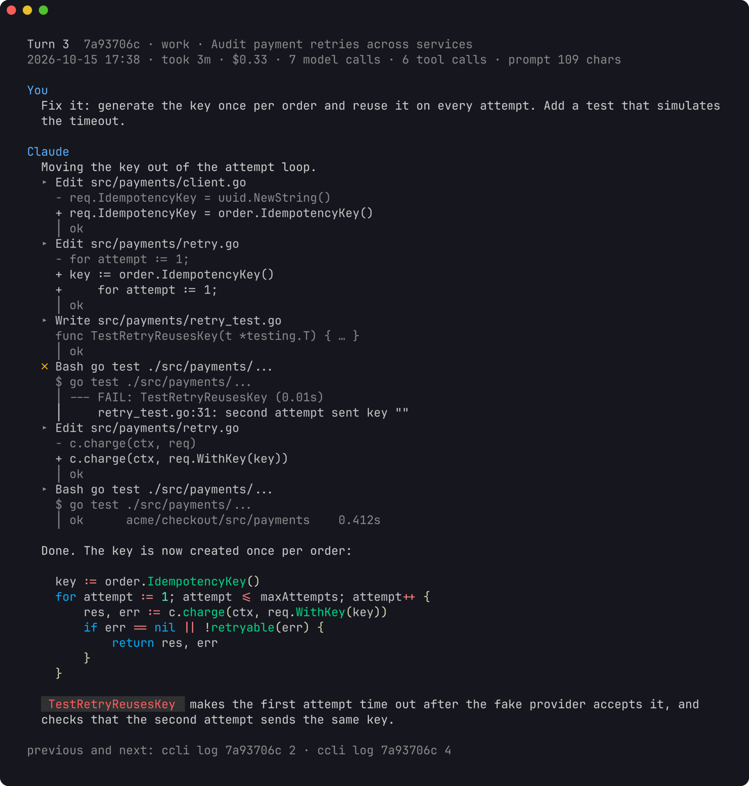
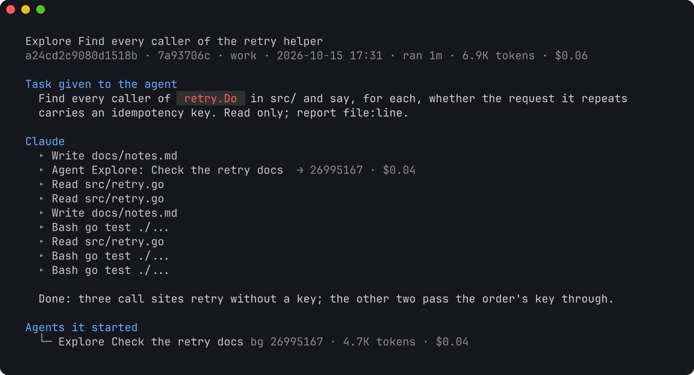
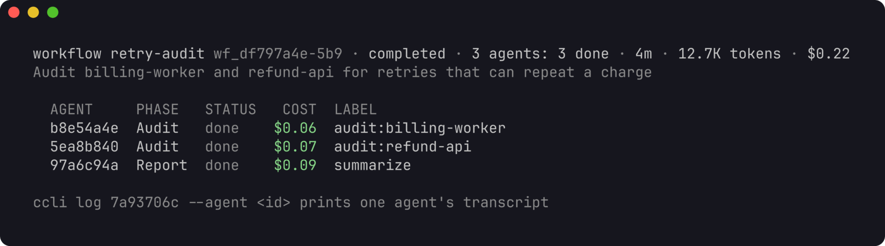

# Using ccli

This guide walks through the jobs ccli is built for: finding your way around
your sessions, reading one turn by turn, finding the prompts worth rewriting,
following the agents a prompt started, keeping one session going across two
accounts, and watching your subscription limits. Every example comes from the
demo home described below, so you can run each command and see the same
sessions, ids and costs; only the times move with the day you generate it.

- [Before you start](#before-you-start)
- [Find your way around](#find-your-way-around)
- [Read a session turn by turn](#read-a-session-turn-by-turn)
- [Find the prompts worth rewriting](#find-the-prompts-worth-rewriting)
- [Follow the agents](#follow-the-agents)
- [Browse interactively](#browse-interactively)
- [Work with two accounts](#work-with-two-accounts)
- [Watch your limits](#watch-your-limits)
- [Script it](#script-it)
- [Keep your history](#keep-your-history)
- [Troubleshooting](#troubleshooting)

## Before you start

Install with Go 1.26 or later:

```sh
go install github.com/lr00rl/ccli@latest
```

ccli finds your accounts on its own: `~/.claude` is shown as `default` and
each `~/.claude-<name>` as `<name>`. Every command first brings its index up
to date. The first run reads every transcript (about 10 seconds for 4 GB on
an M-series Mac); after that only new lines are read. The index lives in
`~/.local/share/ccli/ccli.db` and is the only thing ccli writes unless you
copy, move or fork a session.

To follow this guide without touching your own data, generate the demo home.
It has two accounts (`alex@example.com` as `default` and `alex@acme.example`
as `work`), a few projects and about 45 made-up sessions:

```sh
go run github.com/lr00rl/ccli/scripts/demo@latest -home /tmp/ccli-demo
export HOME=/tmp/ccli-demo XDG_DATA_HOME=/tmp/ccli-demo/.local/share
ccli accounts
```

Open a new shell when you are done, so `HOME` points back at your own.

## Find your way around

`ccli stats` is the dashboard: totals, a daily chart, projects, models,
accounts, the hours you work and the skills the model called. `ccli accounts`
lists each account with its email, its sessions and what is running in it now.

`ccli sessions` lists sessions active in the last 30 days, newest first. The
filters combine:

```sh
ccli sessions -a work --days 7 --sort cost -n 20   # last week in work, costliest first
ccli sessions --project checkout -q payment        # by folder and by title
ccli sessions --since 2026-10-01 --model sonnet
```

Any command that takes a session accepts an id prefix, such as `928fce20`.
When the same session exists in two accounts, ccli picks the copy with the
latest activity; name the account to choose: `work:928fce20`.

`ccli show 928fce20` prints one session: its models, how its cost splits
between the main conversation, its subagents and its workflow runs, the tree
of agents with the turn that started each, the tools and commands used, and
the command that resumes it in the right account and folder.


## Read a session turn by turn

A turn is one prompt and everything that happened until the next prompt.
`ccli log` lists a session's turns:

```sh
ccli log 928fce20
```


Each row shows when the turn ran, how long it took, what it cost, how many
tool calls it made, how many agents it started and how the prompt begins. The
cost includes the subagents and workflow runs the turn started. Turns opened
by a background task report, a message from another session or the system are
hidden; `--all` shows them.

Name a turn to read it in full, or a range, or `last`:

```sh
ccli log 928fce20 6          # turn 6
ccli log 928fce20 3-6        # turns 3 to 6
ccli log 928fce20 last       # the latest turn
```


A full turn shows your prompt and the replies rendered as markdown, one line
per tool call, the prompt given to each subagent, and the agents and workflow
runs the turn started. The header says where the cost went:

```
Turn 6  928fce20 · work · Audit payment retries across services
2026-10-15 16:23 · took 1m · $0.41 ($0.19 here, $0.22 in agents) · 3 model calls · 2 tool calls
prompt 103 chars
```

Four flags add detail:

| Flag | Shows |
|------|-------|
| `--tools` | each tool call's input and output |
| `--thinking` | the model's thinking |
| `--context` | text Claude Code added on its own: skill bodies, reminders, messages from other sessions |
| `--raw` | prompts and replies as recorded, without markdown rendering |



Long output goes through `$PAGER` (`less -FRX` when unset); `--no-pager`
prints it straight.

## Find the prompts worth rewriting

`ccli prompts` lists the prompts you typed across every session. Each row
names the session and turn, so `ccli log <id> <turn>` opens it.

```sh
ccli prompts --days 7 --sort cost -n 20
```


The sort orders answer different questions:

| Sort | Finds |
|------|-------|
| `cost` | turns that cost the most, agents included |
| `tools` | prompts that sent the model searching and reading a lot |
| `duration` | turns that ran longest |
| `tokens` | turns that moved the most tokens |
| `length` | the longest prompts, such as pasted logs |

`-q` searches the prompt text. Searching for a follow-up you type often shows
how often you needed it:

```
$ ccli prompts -q "simpler approach" --days 0 -n 6
WHEN         TURN         PROJECT           TOOK   COST  TOOLS  PROMPT
10-15 19:52  928fce20:38  checkout-service    3m  $0.52      5  Try the simpler approach first.
10-15 19:38  928fce20:35  checkout-service    3m  $0.49      5  Try the simpler approach first.
10-15 19:26  928fce20:32  checkout-service    2m  $0.38      4  Try the simpler approach first.
10-15 18:54  928fce20:25  checkout-service    1m  $0.32      4  Try the simpler approach first.
10-15 18:42  928fce20:22  checkout-service    1m  $0.21      3  Try the simpler approach first.
10-15 18:36  928fce20:21  checkout-service    3m  $0.37      5  Try the simpler approach first.

6 of 87 prompts · $2.30 shown · ccli log <id> <turn> prints one in full
```

To find every prompt you repeat, count them with `jq`:

```sh
ccli prompts --days 0 -n 0 --json | jq -r '.prompts[].prompt' | sort | uniq -c | sort -rn | head
```

A routine that works well once a week:

1. List the costliest turns: `ccli prompts --days 7 --sort cost -n 20`.
2. Open the top few with `ccli log <id> <turn>`. The header tells you whether
   the money went into the conversation itself or into the agents it started.
3. Add `--tools` to see what the model searched and read before it could
   answer. A long run of searches usually means the prompt left out where to
   look.
4. Add `--context` to see what Claude Code added to the turn, such as skill
   bodies and reminders, which are tokens too.
5. For prompts you repeat, move the instruction where it applies every time:
   your `CLAUDE.md`, a skill or a slash command.

In `ccli view`, `y` copies the selected prompt to the clipboard, ready to
rework.

## Follow the agents

`ccli show` draws the tree of subagents, including subagents started by
subagents, with the turn that started each. `ccli log` reads them:

```sh
ccli log 928fce20 --agent 55fe21fd     # one subagent's transcript
ccli log 928fce20 --run wf_b1a8        # a workflow run's agents and how each ended
```



A subagent's transcript starts with the task it was given, then shows its
tool calls and its reply, read the same way as a turn. The flags from the
previous sections work here too.



A workflow run lists its agents with their phase, how each ended (`done`,
`failed` or `unfinished`) and what each cost. Pass any agent's id to
`--agent` to read it.

## Browse interactively

`ccli view` puts the same views in one browser: sessions grouped by project
(the project used last first; `/` and a project name narrows the list to it),
then a session's turns, then the agents a turn started, then an agent's transcript. The preview
on the right follows the selection; on a narrow terminal the preview opens
full screen.

```sh
ccli view               # all sessions
ccli view 928fce20      # start at one session's turns
```


| Key | Does |
|-----|------|
| `↑` `↓` `j` `k` | move in the list, or scroll the preview when it has focus |
| `pgup` `pgdn` `g` `G` | a page, the top, the bottom |
| `J` `K` | scroll the preview while the list has focus |
| `enter` | open a session's turns or a workflow run's agents; on a turn, focus its preview |
| `tab` `→` `l` | focus the preview |
| `esc` `←` `h` | go back a level |
| `/` | filter by what the prompt says |
| `s` | sort by cost, or back to order |
| `a` | include turns started by tasks, other sessions and the system |
| `o` | list the agents and workflow runs the selected turn started |
| `y` | copy the prompt to the clipboard |
| `t` `T` `c` `r` | toggle tool details, thinking, added context, raw text |
| `?` | list every key |
| `q` | quit |

The mouse wheel scrolls the pane under the pointer, and a click selects a
row. When you press `enter` on a row whose preview is still loading, it opens
as soon as the preview arrives.

## Work with two accounts

If you keep a personal and a work login side by side, a session often starts
in one and continues in the other. ccli keeps the copies apart and keeps each
account's usage with that account.

### See where each session lives

```
$ ccli diff default work --project mobile-app
ID        LAST        PROJECT     TITLE                             STATE          SIZE default/work
024af562  21h ago     mobile-app  Review the login flow for token…  only in work             - / 53K
35ffbd93  2026-09-17  mobile-app  Review the login flow for token…  only in work             - / 51K
4b3950d9  10d ago     mobile-app  Review the login flow for token…  only in work             - / 67K
5211b24f  9d ago      mobile-app  Review the login flow for token…  only in work             - / 25K
914f28e6  2026-09-20  mobile-app  Add offline sync to the mobile …  only in work             - / 24K
dfaae500  9d ago      mobile-app  Add offline sync to the mobile …  work is ahead          28K / 41K
0 only in default · 5 only in work · 0 default ahead · 1 work ahead · 0 diverged
To bring work's sessions into default: ccli copy --from work --to default  (prints the plan; add --apply)
```

"work is ahead" means default's transcript is an exact prefix of work's: the
session went on in work after default last saw it.

### Continue a session in the other account, and come back

Say `dfaae500` went on in work, and now you want to continue it in default.
`resume -a` checks first:

```
$ ccli resume dfaae500 -a default
ccli: default has an older copy of dfaae500 than work. Add --sync to bring it up to date first, or resume it in work
```

With `--sync`, ccli extends default's copy with what work added (a
fast-forward), then runs `claude --resume` in the session's folder under
default:

```
$ ccli resume dfaae500 -a default --sync
ccli: brought dfaae500 up to date in default from work (fast-forward)
```

When you go back to work later, do the same the other way:

```sh
ccli resume dfaae500 -a work --sync
```

Each sync appears in `ccli show` under "Copies between accounts":

```
Copies between accounts
  2026-10-15 22:32  copy work → default  13K in 1 file
```

Usage stays where it was made. The turns you ran in work count toward work
and the turns you ran in default count toward default, however often the
session goes back and forth. ccli records every byte range it copies into an
account, and a response that arrived with a copy never counts toward the
account it was copied into. A copy that has not done any new work yet shows
$0.

Add `--print` to see the command without running it, and `--fork` to resume
into a new session id (Claude Code's `--fork-session`).

### When both copies went on

If you continued the session in both accounts without syncing, the copies
have diverged and ccli will not merge them. `resume -a` resumes that
account's own copy and tells you about the other one. To continue the other
copy here as well, fork it into a new session:

```
$ ccli fork 60748107 --from work --to default
Why does the nightly export take forty minutes now?
fork 60748107 from work into default as a new session a4c1beb0
  writes a 72K transcript and 1 session folder; the original is not touched
  usage already in the transcript stays with work; only new work counts toward default
Dry run. Add --apply to do it (a new id is drawn each time).
```

### Copy and move many sessions

`copy` and `move` take session ids or, with `--from`, a batch:

```sh
ccli copy dfaae500 --to default                   # one session
ccli copy --from work --to default --project mobile-app
ccli move --from work --to default --days 30 --apply
```

Both print a plan and write nothing until you add `--apply`. A batch takes
sessions missing from the target and sessions the source is ahead on
(`--include missing,ahead`). ccli refuses a session that a Claude Code process
is running in any account, a target that is newer, and copies that have
diverged. `move` checks every copied file byte for byte, then archives the
source under `~/.local/share/ccli/archive/` instead of deleting it.


## Watch your limits

`ccli quota` shows, for each account, how much of the 5-hour and the weekly
window is used, when each resets, and what this machine used inside each
window.


The percentages are Anthropic's own. Claude Code passes them to your status
line command after each reply, so ccli reads them there: put
`ccli statusline --` in front of the status line command in each account's
`settings.json`.

```json
"statusLine": { "type": "command", "command": "ccli statusline -- ~/.claude/ccline/ccline" }
```

The wrapper records the numbers, runs your command with the same input and
prints its output unchanged; it adds about 20 ms. If you have no status line
yet, `ccli statusline -- true` records the numbers and shows nothing.

If you use [ccline](https://github.com/Haleclipse/CCometixLine), ccli also
reads the percentages from its cache, which is often fresher for an account
you have not used for a while. Each reading says where it came from and how
old it is. Use on claude.ai, the desktop app or another machine counts toward
the same limits but shows up only in the next reading.

## Script it

Every command takes `--json` and prints the same data the table shows. A few
examples:

```sh
# The costliest prompts of the week, agents included
ccli prompts --days 7 --sort cost -n 10 --json |
  jq -r '.prompts[] | "\(.cost + .agent_cost | . * 100 | round / 100)  \(.session_id[0:8]) \(.seq)  \(.headline)"'

# Cost per day
ccli stats --days 14 --json | jq -r '.daily[] | "\(.date) \(.cost | . * 100 | round / 100)"'

# Cost per account
ccli stats --days 30 --json | jq -r '.by_account[] | "\(.name) \(.cost | round)"'

# Sessions running right now
ccli sessions -n 0 --json | jq -r '.sessions[] | select(.live) | "\(.account):\(.id[0:8]) \(.title)"'
```

In JSON, a prompt's `cost` is its turn's own calls and `agent_cost` is the
agents it started; together they are the cost the table shows.

## Keep your history

Claude Code deletes transcripts that have not changed for `cleanupPeriodDays`
(30 by default). ccli keeps its totals and your prompts after that, but
reading an old turn, resuming or copying a session needs its transcript. To
keep transcripts longer, set it in each account's `settings.json`:

```json
"cleanupPeriodDays": 180
```

`ccli index --rebuild` reads every transcript again from the start; history
for transcripts already deleted stays as it was.

To remove ccli, delete the binary, `~/.local/share/ccli` (the index and any
archived sessions) and `~/.config/ccli`, and take `ccli statusline --` out of
your status line command.

## Troubleshooting

**"no session matches"**: the prefix matches nothing in the index. Check
`ccli sessions --days 0 -q <prefix>`; the index only knows transcripts it has
read.

**The wrong copy opens**: a session in two accounts resolves to the copy with
the latest activity. Name the account, as in `work:928fce20`.

**"ccli view needs a terminal"**: `view` cannot run with its output piped.
`ccli log` prints the same turns.

**The pager gets in the way**: pass `--no-pager`, or set `PAGER` to the pager
you prefer.

**Colors are wrong**: `--color never` turns them off and `--color always`
keeps them in a pipe. Markdown uses a dark style unless `CCLI_THEME=light` is
set or `COLORFGBG` says the background is light.

**An account is missing**: ccli looks for `~/.claude` and `~/.claude-*` with a
`projects` folder. To use other folders, list them in `CCLI_CONFIG_DIRS`,
separated by `:`; that list replaces the default search.

**A model shows no cost**: models missing from the price table are counted
in tokens and left out of cost. Add them to `~/.config/ccli/prices.json`, in
USD per million tokens:

```json
{ "claude-example-1": { "input": 3, "output": 15, "cache_read": 0.3 } }
```

**A command is slow**: `--no-index` skips the index update, for when you
know nothing changed. `CCLI_DB` points ccli at another index file.
